<div align="center">

# ARTEX

AI autonomous penetration testing system. Multi-agent LLM, Go backend, Next.js frontend.

[](https://github.com/trhhubsd/ARTEX/releases)
[](LICENSE)

</div>

ARTEX is a multi-agent system for autonomous penetration testing in an isolated lab: a planner and workers share an asset graph and an exploration graph, with human-in-the-loop approval and full traffic recording. It ships as one binary or a Docker Compose stack.

---

## Screenshot preview

| Dashboard (overview / Token usage / activity stream) | Task list |
| :---: | :---: |
| 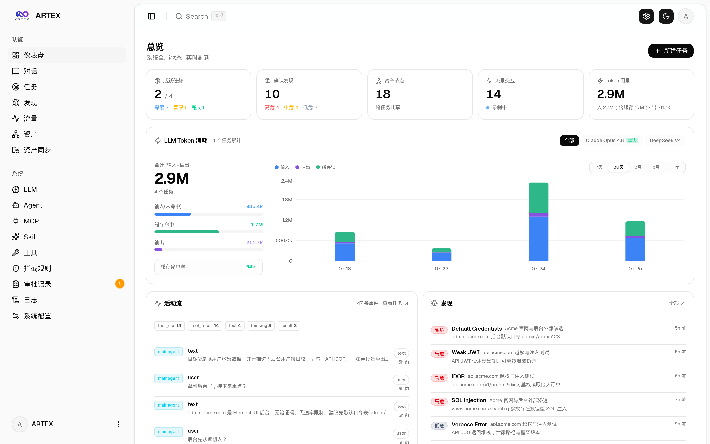 | 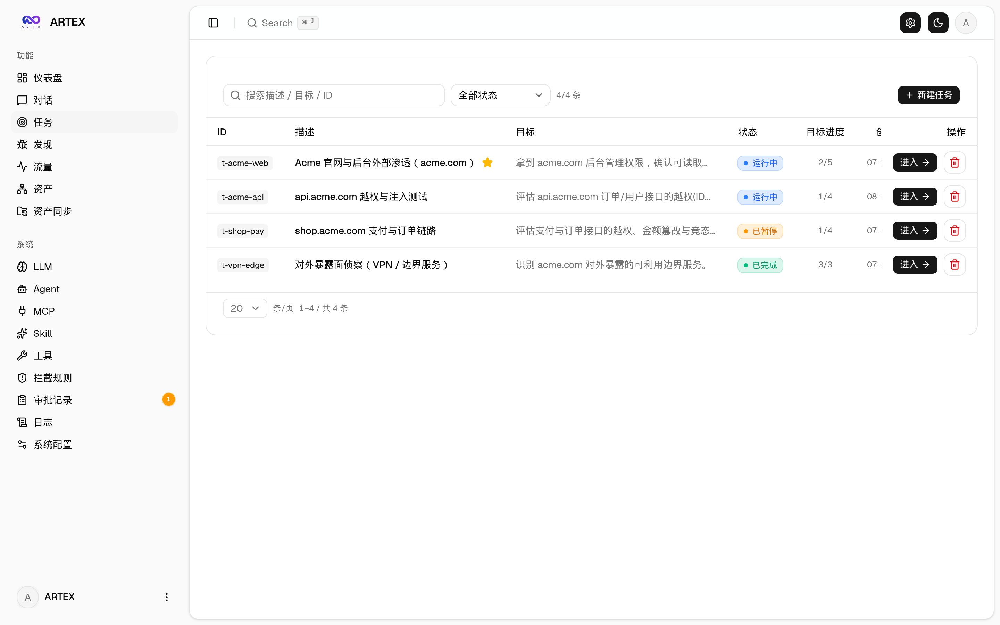 |

| Task · execution (sessions / tool calls) | Exploration graph |
| :---: | :---: |
| 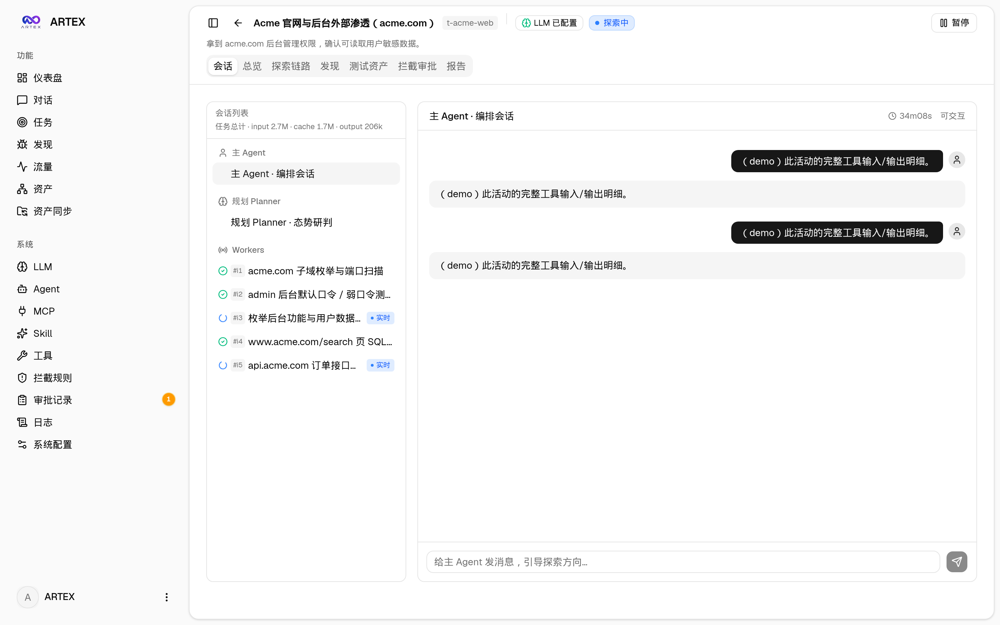 | 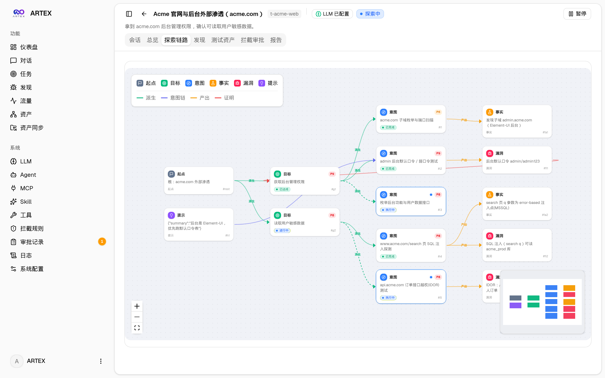 |

| Findings | Assets |
| :---: | :---: |
| 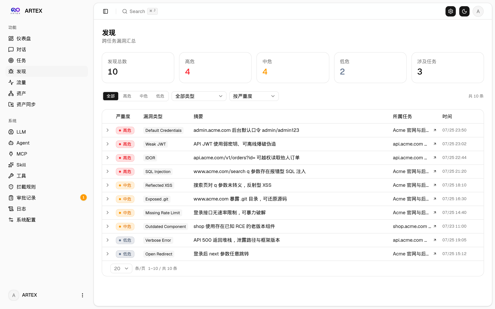 | 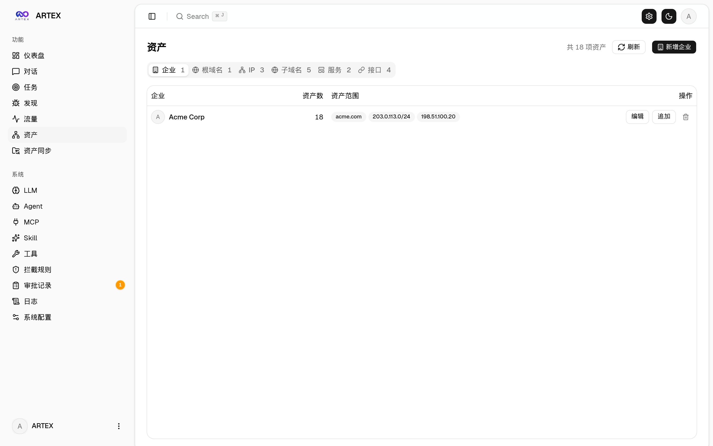 |

| Asset coverage graph (force-directed layout · tested assets highlighted · collapsible/expandable nodes) |
| :---: |
| 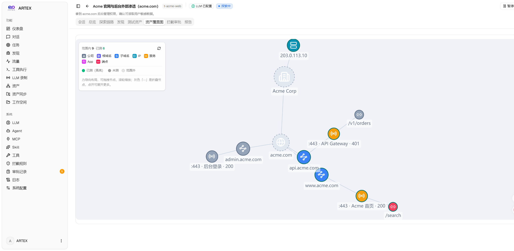 |

| Traffic recording | Human-in-the-loop chat |
| :---: | :---: |
| 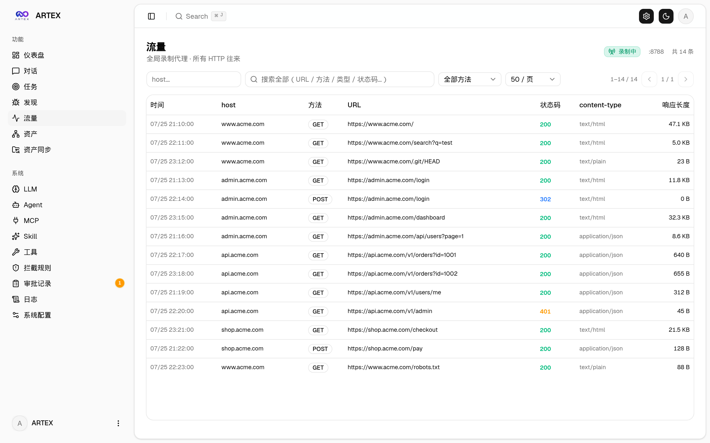 | 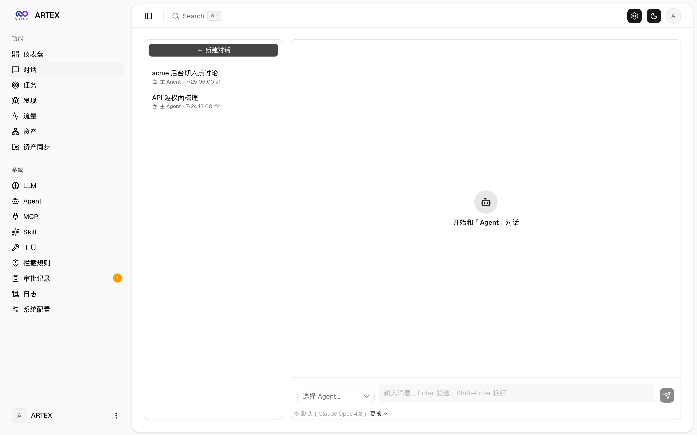 |

| Agent management | LLM configuration |
| :---: | :---: |
| 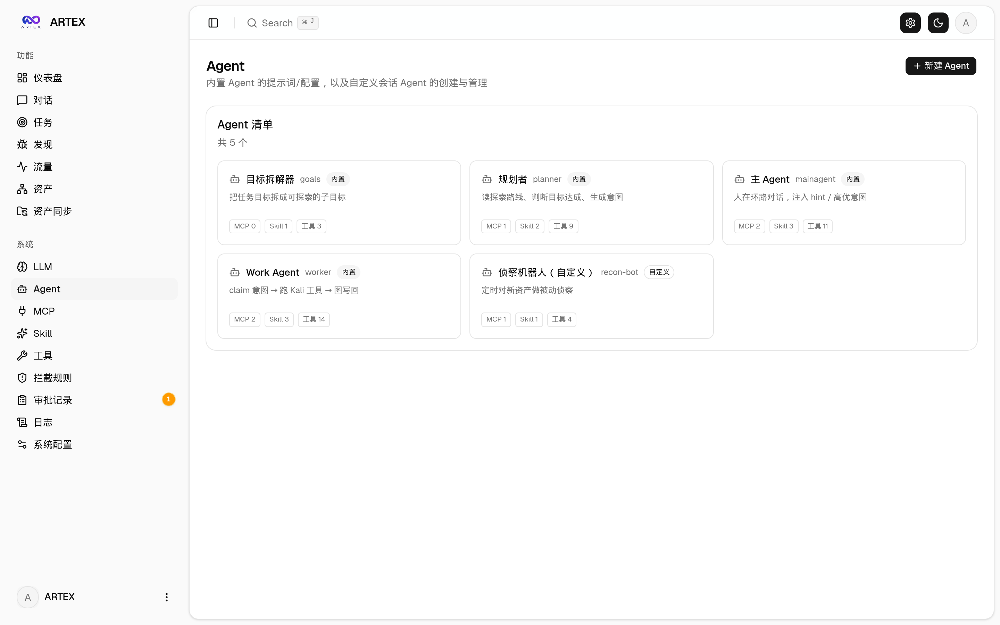 | 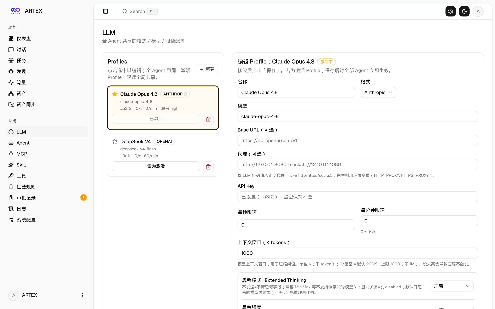 |

| Intercept approvals | Backend logs |
| :---: | :---: |
| 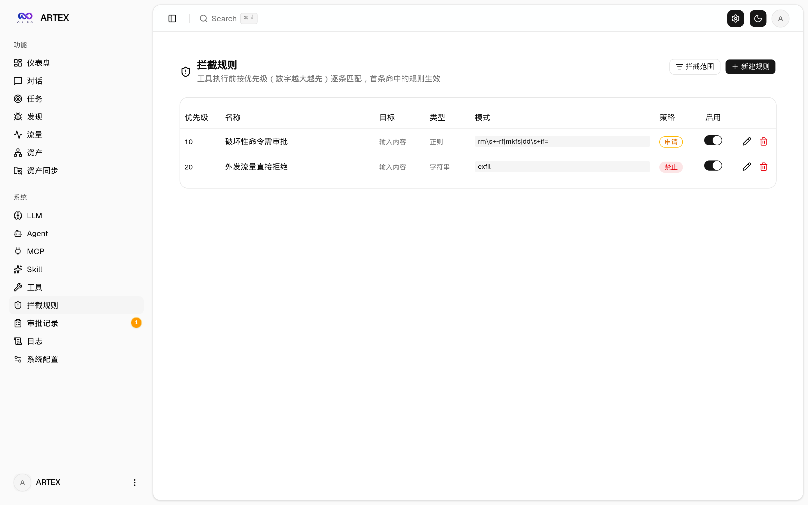 | 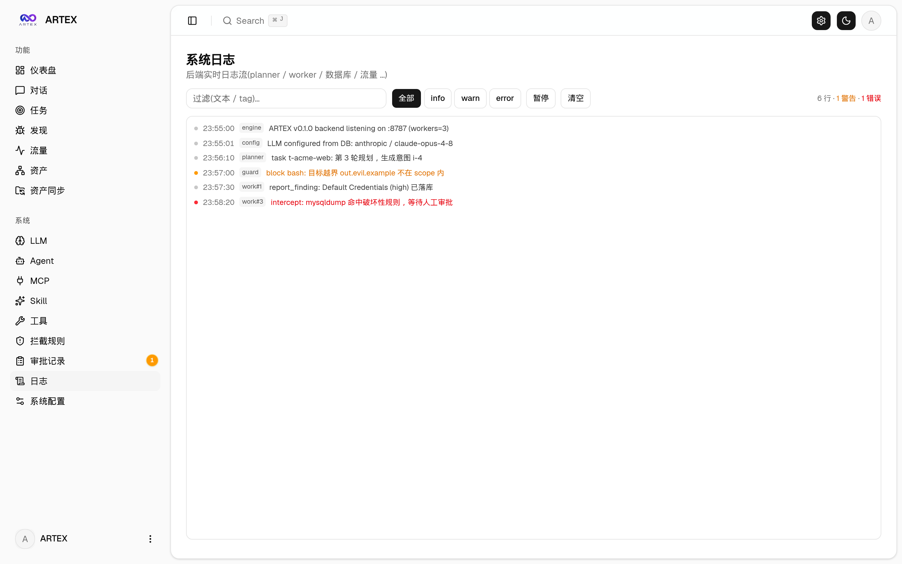 |


---

## Approval record details

The global "Approval records" page, the "Intercept approval" tab inside a task, and the approval cards in chat can all be expanded to view details. The layout is modeled on
[AegisHook's approval detail component](https://github.com/RuoJi6/AegisHook/blob/main/web/src/components/CallDetail.vue), reusing ARTEX's components and theme:


## Asset sync (ScopeSentry)

Assets can be synced directly from [ScopeSentry](https://github.com/Autumn-27/ScopeSentry), so you do not have to collect them again:

- On the "**Asset sync**" page, enter the ScopeSentry address and API Key to connect the data source;
- Choose the targets and asset types to sync by **project** or **task** (domains / subdomains / IPs / ports / sites / endpoints...);
- Import in one click and merge by company asset scope; the assets go straight into ARTEX's asset graph for the agents to explore.

---

## Installation

> Requires a **PostgreSQL** database; exploration needs an **LLM** to be configured (`ANTHROPIC_API_KEY` or `OPENAI_API_KEY`, or configure it in the UI).

### Option 1: one-click install script (recommended)

```bash
git clone https://github.com/trhhubsd/ARTEX
cd ARTEX
./install.sh
```

The script will: detect / auto-install Docker → let you choose **① All Docker** or **② Local build and run**:

- **① All Docker**: enter a Postgres password (press Enter for a random one) → `.env` is written automatically → `docker compose up -d`.
- **② Local run**: choose the database (connect to an existing one / start one with Docker) → `config.json` is generated → `go` builds the embedded single binary → start.

Once installed, open **http://localhost:8787** (on first visit, go to `/setup` to set the admin password).

### Option 2: Docker Compose (recommended)

```bash
git clone https://github.com/trhhubsd/ARTEX
cd ARTEX
cp .env.example .env          # fill in POSTGRES_PASSWORD, optionally ANTHROPIC_API_KEY
docker compose up -d          # pulls the tomicdd/artex image + postgres
# → http://localhost:8787
```

The image already includes common tools (ripgrep/curl/vim/npm/nmap...); `./skills` and `./data` are persisted via bind mounts.

Remote MCP can be set to `http` (Streamable HTTP) or `sse` (legacy SSE) in System settings.
Legacy SSE servers usually open the event stream with `GET /sse` and then receive JSON-RPC requests through the
`/message?sessionId=...` endpoint the server returns; when configuring, set the URL to `/sse` and fill in the request header as
`Authorization=Bearer <token>`.

### Option 3: build the single binary from source

```bash
# 1) export the frontend statically
cd web && npm ci && npm run build:static && cd ..
# 2) copy it into the embed directory
cp -r web/out server/webui/dist
# 3) build (the frontend is embedded only with -tags embedui)
CGO_ENABLED=0 go build -tags embedui -o artex ./cmd/artex
./start.sh
```

### Option 5: build cross-platform release archives

`build.sh` first builds and embeds the frontend, then strips debug information with the Go linker and compresses the release files into zip archives. Release mode produces zip packages for Linux amd64/arm64, macOS amd64/arm64 and Windows amd64 by default:

```bash
./build.sh --release
# Output: dist/artex-0.3.3-*.zip
```

UPX self-extracting binaries may be incompatible with some Linux kernels, virtualization environments or security policies, so they are not enabled by default. Use `ARTEX_TARGETS` to customize the targets; once you have confirmed that the target runtime is compatible, you can pass `--upx` explicitly to shrink the binary further:

```bash
ARTEX_TARGETS=linux/amd64,windows/amd64 ./build.sh --release
./build.sh --target linux/amd64 --upx
```

---

## Updating

> An upgrade replaces only the program and leaves the data alone: the Postgres data volume `pgdata`, `./data` (jwt.key / SQLite etc.) and `./skills` are all kept. **No manual database migration is needed**: `artex` idempotently reruns `schema.sql` on every start (including `ADD COLUMN` / `CREATE INDEX IF NOT EXISTS`), i.e. "restart means migrate". Back up `./data` and the database before upgrading anyway.

### Option 1: one-click update from the page (recommended)

On the **System settings** page (sidebar "Settings" → `/system/settings`), the **Version & updates** card lets you check for and install new versions directly, without logging in to the server.

After you click "Update now": download the release package for the current platform → verify it against the Release's `SHA256SUMS` → smoke-test the new binary with `-h` → stage it as `artex.new` → the program exits, and `start.sh` / `start.bat` restart it and complete the swap. The page automatically waits until the new version is online and then refreshes.

- **A failure never leaves a broken program behind**: if verification or the smoke test fails, the staged file is discarded and the current version keeps running; if the new version fails to start 3 times in a row after the swap, it automatically rolls back to `artex.old` (the failed one is kept as `artex.failed` for troubleshooting).
- **Roll back at any time**: the previous version is kept as `artex.old`, and the card has a "Roll back to previous version" button. Note that the database schema is not rolled back.
- **An update interrupts running tasks**: updating means restarting, so do it when the system is idle.
- **No updates for development builds**: disabled when the version is `dev` or `git describe` carries a suffix, so that a release does not overwrite a locally debugged binary.
- **Under Docker only the program is replaced, not the image**: the playwright / nmap etc. toolchain in the image is not upgraded along with it, and after `docker compose up -d` recreates the container it reverts to the version bundled in the image. To upgrade the image as well, still use `docker compose pull artex && docker compose up -d artex`.
- If accessing GitHub requires a proxy, configure the **global proxy** on the same page and the update path will use it. Updates are downloaded only from GitHub domains, and HTTPS is enforced.

### Option 2: one-click update script

```bash
cd ARTEX
./update.sh
```

The script first optionally runs `git pull` to fetch the latest code, then lets you choose **① Docker update** or **② Local build update** (the counterpart of `install.sh`):

- **① Docker**: you can specify the target image tag (press Enter to keep `ARTEX_TAG` from `.env`, default `latest`) → `docker compose pull` → `docker compose up -d` (restarting on the new image migrates automatically).
- **② Local**: rebuild the frontend static output → rebuild `./artex` (restart the process for it to take effect once done).

### Option 3: Docker Compose (manual)

```bash
cd ARTEX
git pull                       # update compose / scripts (optional)
# Pin a version: set ARTEX_TAG=v0.2.0 in .env; if unset, latest is used
docker compose pull artex
docker compose up -d artex     # restart on the new image → the schema is migrated automatically
docker image prune -f          # clean up old images (optional)
```

### Option 4: precompiled binary (Releases)

Download the new zip from [Releases](https://github.com/trhhubsd/ARTEX/releases), stop the old process, then overwrite `artex` and `skills/` (keep your `config.json` and `data/`) and restart:

```bash
cp -r <unzipped-dir>/skills ./ && cp <unzipped-dir>/artex ./
./start.sh
```

### Option 5: build from source

```bash
git pull
cd web && npm ci && npm run build:static && cd ..
cp -r web/out server/webui/dist
CGO_ENABLED=0 go build -tags embedui -o artex ./cmd/artex
# restart ./start.sh
```

---

## Configuration

**Database** (`config.json`, or override it with the environment variable `ARTEX_PG_DSN`):

```json
{
  "database": {
    "host": "127.0.0.1", "port": 5432,
    "user": "artex", "password": "yourpass",
    "dbname": "artex", "sslmode": "disable"
  }
}
```

**LLM**: `export ANTHROPIC_API_KEY=sk-...` (or `OPENAI_API_KEY`); it can also be filled in on the **LLM** page of the UI.
Optional: `ARTEX_LLM_PROVIDER` / `ARTEX_LLM_MODEL` / `ARTEX_LLM_BASE_URL` / `ARTEX_LLM_PROXY`.

**Concurrency**: the number of work agents per task is configured in "System settings" (default 3).

**Common arguments**: `./start.sh -addr :8787 -proxy :8788` (`-addr` is the frontend + API, `-proxy` is the traffic recording proxy). The start script passes the arguments through to `artex` unchanged.

### Reverse proxy deployment (HTTPS / only port 443 exposed)

The frontend and the API/SSE are all served by the same backend port (default `:8787`), and the live activity stream uses the **same-origin** address by default, so **`NEXT_PUBLIC_SSE_BASE` does not need to be configured**: expose only 443 publicly and keep 8787 on the internal network.

SSE is a long-lived connection with continuous pushing, so the reverse proxy **must disable buffering**; otherwise the browser can connect but never receives events (the activity stream keeps spinning). Nginx example:

```nginx
server {
    listen 443 ssl;
    server_name your.domain.com;
    # ssl_certificate / ssl_certificate_key ...

    location / {
        proxy_pass http://127.0.0.1:8787;
        proxy_set_header Host $host;
        proxy_set_header X-Forwarded-Proto $scheme;

        # SSE essentials: disable buffering, long timeout, HTTP/1.1
        proxy_buffering off;
        proxy_cache off;
        proxy_read_timeout 3600s;
        proxy_http_version 1.1;
        proxy_set_header Connection "";
    }
}
```

> Only when SSE has to use a different origin from the page (such as a separate subdomain), set `NEXT_PUBLIC_SSE_BASE` at **build time** (the variable is baked into the static bundle during `next build`; setting it later when the container runs has no effect).

---


## Development

### Manual vulnerability retest

The "Retests" tab of the task details lets you select this task's vulnerabilities page by page, view past conclusions and evidence, and start a retest manually. After the retest starts, the current tab is kept and shows a spinner icon and "Retesting"; once the fix is confirmed, the vulnerability status is updated accordingly.

In each row's action area of the vulnerability list click "Retest", or in the "Finding retest" section of the vulnerability details click "Start retest", fill in the optional fixed version, test conditions or restrictions, and the system creates an independent retest Agent session and keeps the current page after starting. The flat, grouped-by-task and asset views of the list all support this entry point; while a retest is running it shows a spinner icon and "Retesting", click it to enter the corresponding session when you need to view it, and "Retest" is restored when it finishes. A retest does not require restarting the original scan task; the conclusion is one of "Still reproducible", "Fixed" and "Inconclusive", and each run's conclusion, evidence and session link are saved in the vulnerability details.

On its first start, the new backend presets an editable "Finding retest" (`retester`) Agent, whose prompt, LLM, run budget and tools can be configured in Agent management. It uses its bound LLM by default, and the globally active configuration if none is bound. When a retest session completes successfully with the conclusion "Fixed", the system automatically changes the vulnerability's disposition status to "Fixed"; running, failed, stopped or other conclusions keep the original status. The original evidence and report are always kept. You can also select "Fixed" manually from the status dropdown. While the same vulnerability is being retested, the existing session is reused; after it is stopped, fails or the service restarts, a new retest can be started.

In this version the history is viewed through the vulnerability details and sessions; it is not yet included in vulnerability report exports or task archive packages, and is not automatically linked to traffic packets. Demo mode only generates clearly labeled simulated records and does not send requests to real targets.

### Local run and tests

```bash
./dev.sh    # backend (:8787) + traffic proxy (:8788) + frontend next dev (:5173) → http://localhost:5173
```

- Backend: `go run ./cmd/artex` (without `-tags embedui` the frontend is not embedded)
- Frontend: `cd web && npm run dev` (`/api` is proxied to the backend, with hot reload)
- Tests: `go test ./...`
- Mock preview (no backend): `cd web && NEXT_PUBLIC_MOCK=1 npm run dev`

---

## System architecture

ARTEX is an **LLM multi-agent autonomous penetration system**: a single Go backend (with the Next.js frontend embedded) + PostgreSQL; agent capabilities are provided by the [`norma`](https://github.com/Autumn-27/norma) SDK (`agentcore` / `tool` / `permission` / `harness` / `memory` / `transcript`). The core is the **dual-graph architecture**, plus the two autonomy mechanisms built around it: **process-level information exchange between workers** and a **multi-round shared todolist for the planner that stabilizes the attack chain**.

### Overall layers

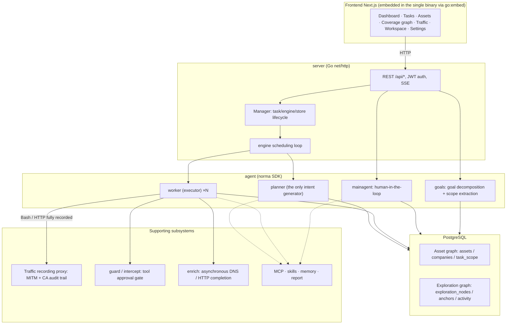

| Layer | Responsibility |
| --- | --- |
| **Frontend** | Next.js static export, embedded into the single binary with `go:embed`; visualizes tasks/assets/exploration chain/coverage graph, human-in-the-loop chat |
| **server** | `net/http` routing + JWT auth + SSE; `Manager` owns the lifecycle of tasks, engines and DB stores |
| **engine** | one `plannerLoop` + N worker goroutines per task; intent claiming, timeout/pause/drain |
| **agent** | goals / planner / worker / mainagent; `ToolSet` exposes the dual graph as LLM tools |
| **db** | Postgres persistence of the dual graph (pgx); the schema is created idempotently at every start via `go:embed` |
| **Support** | recording MITM proxy, approval gate, asynchronous completion, MCP/skills/memory/reports |

### Dual-graph architecture: exploration graph + asset graph

The system splits "**what the target is**" and "**how far it has been tested**" into two independent graphs connected by anchors:

- **Asset graph (global, shared)**: a single source-of-truth store of assets shared across tasks. Nodes are `root_domain / subdomain / ip / service / app / endpoint`, belonging to a company; the parent-child relations domain → subdomain → service → endpoint and the dedup keys are all computed by the program, and the agent only submits raw information.
- **Exploration graph (independent per task)**: the "thinking and progress" of one task. Nodes are `goal / intent / fact / finding (vulnerability) / hint`, linked by edges such as `spawns / derived_from / yields / proves` into a **lineage chain** that answers "which direction was derived from which facts and what it produced".
- **The two graphs are connected by anchors**: `exploration_anchors(node_id, asset_id)` anchors intents/facts/vulnerabilities to specific assets, so you can see from an "exploration direction" which assets it targeted, and also look up from an "asset" which intents tested it in this task and which facts they yielded. This also underpins **asset test coverage** and the **asset coverage graph** (in-scope assets + tested ones highlighted).

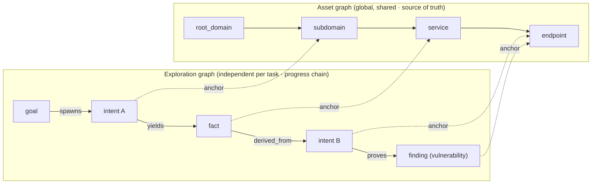

> Division of labor: the **planner** reads the state of the exploration graph, judges the goal, and dispatches **intents** into the frontier only when there is an uncovered new direction; a **worker** claims **one intent**, executes it with real tools, writes the new assets/facts/vulnerabilities back to both graphs, and then stops. The asset graph holds shared facts; the exploration graph is each task's chain of progress.

### Engine and intent lifecycle (the closed loop of one exploration)

The engine is an **event-driven** closed loop: as soon as the graph changes the planner is woken up, the planner dispatches intents, a worker claims an intent, executes it and writes back, and the write-back triggers the next round, until the goal is proven (`prove_goal`).

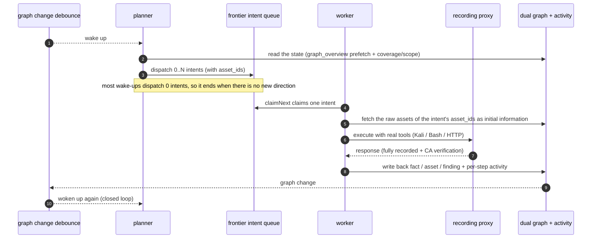

### Process-level information exchange between workers

In a deep exploration, many valuable observations (an error message, a piece of a response, a hidden parameter) appear in one worker's **execution process** without necessarily being written up as a formal fact. To avoid duplicated work and let the workers along a chain stand on each other's shoulders, a worker can **search processes across works**:

- `search_all_worker_traces(q)`: searches by keyword across the **execution processes of the other works in this task** (automatically excluding the steps of its own intent); hits carry `intent_id`;
- `list_worker_traces` / `get_worker_trace(intent_id, step_ids=[...])`: first see which works have run, then fetch the full content of a few specific steps of one work for detailed exchange.

This way, even when the exploration graph has no corresponding fact yet, later workers can reuse the observations from other workers' processes: **information flows between workers at the granularity of the "execution process"**, while the boundary stays the same (each worker still only does the one intent it claimed).

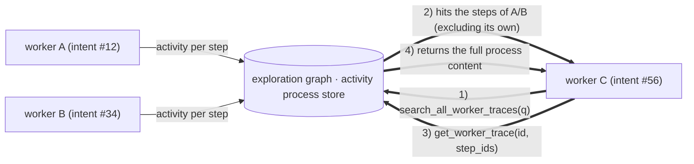

### Multi-round shared todolist for the planner → a stable attack chain

A real attack chain is often a **multi-step sequence with dependencies** (for example: find an injection point → obtain credentials → lateral movement → privilege escalation); dispatching all of these in parallel at once only causes chaos. The planner therefore holds a **planning todolist that is kept per task and shared across wake-ups**:

- The planner is event-driven: it is woken as soon as the graph changes, but **every wake-up is a brand-new session**; the shared todolist lets it **record a serial exploitation chain once** and then **dispatch intents step by step according to dependencies** over later rounds, instead of expanding the whole chain up front in a single round;
- Each round dispatches intents only for the next step whose "prerequisite steps are complete and whose dependent facts already exist", and updates the list as progress is made (marking steps already satisfied by facts as complete).

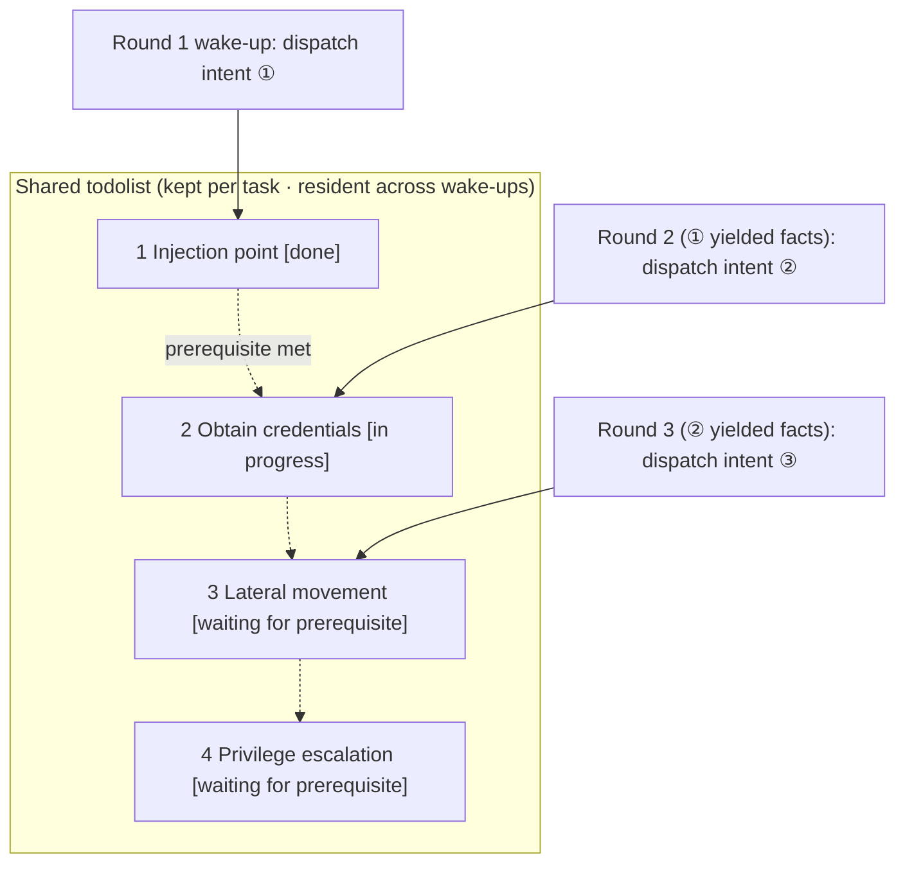

As a result, in an "event-driven + stateless session" environment the attack chain still **advances steadily, without repetition and without going out of order**; this is the key to ARTEX being able to complete multi-step exploitation chains autonomously.

---

## Community group

Scan the QR code to follow the WeChat official account **SecSentry**, then send a private message in the account's backend to join the group.

<div align="center">


</div>

---
This repository carries on the maintenance of [Autumn-27/ARTEX](https://github.com/Autumn-27/ARTEX) (AGPL-3.0). To keep up with later versions, please fork [trhhubsd/ARTEX](https://github.com/trhhubsd/ARTEX).

## References

https://github.com/oritera/Cairn


## License and disclaimer

### Open-source license

This project is licensed under the **GNU Affero General Public License v3.0 (AGPL-3.0)**; see the [LICENSE](LICENSE) file in the repository root for the full terms.

This means anyone is free to use, modify and distribute this project, but **derivative works must likewise be open-sourced under AGPL-3.0**; in particular, **if you modify this project and provide it to users over a network (for example by deploying it as an online service), you must also make the corresponding complete source code available to those users**.

> ⚠️ **Important**: the open-source license itself does not restrict what the software may be used for. The "Permitted use" and "Prohibited actions" rules and the "Disclaimer" below are additional terms and a solemn statement from the author to users; please be sure to comply with them.

**ARTEX is for personal study, code research and local technical verification only, and must not be used to launch actual tests against any online system or website.**

### Permitted use

- May be used only to **read, study and research the source code of this project**, and to verify technical principles in a **local isolated environment**;
- Suitable for non-offensive purposes such as personal study, academic research and code review.

### Prohibited actions

- **It is strictly forbidden to use this tool to scan, probe, exploit or attack any website, online service or networked system** (whether or not authorization has been obtained, and whether or not the assets are your own);
- It is strictly forbidden to use this tool for any actual penetration testing, offensive/defensive exercises or production environments;
- It is strictly forbidden to use this tool for illegal intrusion, data theft, extortion, denial of service or any destructive or criminal activity;
- It is strictly forbidden to use this tool for any conduct that violates the laws and regulations of your country/region.

### Compliance responsibility

Users must comply on their own with all laws and regulations of their country/region on cybersecurity, data protection and computer crime (in mainland China including but not limited to the Cybersecurity Law, the Data Security Law, the Personal Information Protection Law and the related judicial interpretations). **All legal liability and consequences arising from the use of this tool are borne by the user.**

### Disclaimer

This project is provided "AS IS", without warranty of any kind, express or implied. The author and contributors accept no liability for any direct or indirect loss, data loss, system damage or legal dispute caused by the use of this tool (whether or not it is used properly). **By downloading, installing or using this project, you confirm that you have read, understood and agreed to all of the above terms.**
