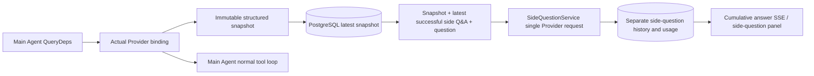

# ARTEX `/btw`

Regular chats, the task MainAgent and the current task's own Workers support standalone side questions. Type `/btw question` in the main input box to submit one; an empty `/btw` or the "Side question" button opens the history. Desktop uses a resizable side panel and mobile uses a Drawer.

A side answer is generated from the agent context snapshot taken at submission time and supports streaming, follow-ups, stop and clear. Closing the panel, refreshing the page or dropping the SSE connection does not cancel the model request. Stop only affects the current side question; clear cancels the side question and deletes the side-question history while keeping the main context snapshot.

## Implementation scope

Built on Go, norma v0.3.7, Next.js and the existing Markdown / ResizablePanel / Drawer / AlertDialog components; norma source was not modified and no dependency was added for side questions. The Planner, Workers inherited from other tasks, and upgrades of tool-type sub-tasks are out of scope for this change.

- `capture.go` only marks main-loop requests at `Options.Deps.CallModel / CallModelSync`. The Provider decorator sits inside the concrete model, after the routing pool's outer selection, so it records the model actually selected; compression and summary requests do not overwrite the snapshot.
- A snapshot is published at request start, on each complete model reply and at the run's final state. A partially generated reply is not published; tool calls stay paired through norma's `MessagesForAPI`, and tool results enter the snapshot on the next main model request or at the run's final state. A streaming abort keeps the previous valid boundary.
- The snapshot keeps structured messages, the system prompt, tool definitions and generation parameters through a JSON deep copy. Model inference holds neither the snapshot lock nor a database transaction.
- `SideQuestionService` calls the concrete Provider; when needed it first generates a side-question summary, and the final answer may be retried once after trimming, only when the context was exceeded for the first time and no text or tool call has been output yet. It creates no agent session and does not connect to the tool executor, the main transcript, the activity stream or the task graph, nor does it go through the task model switch chain. The answer request keeps the tool definitions for compatibility with the existing structured tool context; summary requests provide no tools. Newly returned tool calls have no execution path.
- One running request per parent session and at most four per service process, with a single 120-second timeout. Side questions use an independent cancellation context under the service lifecycle.
- A side-question request keeps the model configuration reference and a non-sensitive identity digest; credentials are obtained from the existing configuration at request time. If the configuration is deleted, or identity fields such as model, protocol or address change, the main Agent must be run first to update the snapshot. Tests do not change the product default model.

## Persistence and recovery

`db/schema.sql` automatically creates `side_question_sessions` and `side_question_requests`. The former stores the parent resource, the latest snapshot, run number, version and clear version; the latter stores the question, cumulative answer, status, model, snapshot time, usage, event sequence number and paging ordinal.

The parent session key is the conversation ID, or task ID + exploration ID + intent ID. Workers do not use reusable execution-slot names.

Snapshots are written per parent session in merged form, flushed every 250 ms, and the database compares `(run_id, version)` so an older version cannot overwrite a newer one. The selected snapshot is saved again before a side question is submitted. After a successful save the large in-memory snapshot is released; on failure the pending version is kept. The cumulative answer is written at most once every 250 ms as streaming events arrive; the final state is saved immediately and retried a limited number of times on database errors.

On service start, leftover `running` requests are marked `interrupted`, keeping the partial answer and usage already stored, and are not replayed automatically. The most recently saved context can be used directly for the next question. A legacy session without a snapshot requires running the main Agent first; the context is not rebuilt from UI activity records.

Clear increments the clear version and deletes the requests; conditional updates stop late callbacks from writing data back. Physical deletion of the parent resource relies on foreign-key cascade, and logical deletion of a Worker removes the side-question data in the same transaction and rejects later snapshots that arrive late. Task archiving first blocks new requests, waits for the main flow to stop, then cancels and waits for side questions to be persisted; the archive format is v3 and remains compatible with v1/v2, which contain no side-question tables.

The full history is stored and returned by ordinal cursor, at most 20 entries per page. A model request replays at most the latest 20 successful Q&A exchanges verbatim, also limited by a token budget; older exchanges are kept in a separate rolling summary. When the main context exceeds the budget, only the older part of the side-question copy is summarized, keeping recent structured tool calls and results. The summaries, preparation progress and usage all count toward the side question's concurrency, cancellation and 120-second timeout limits. See [context budget and open-source references](CONTEXT_BUDGET.md).

## HTTP contract

The following paths act as `{parent}` and reuse the existing authentication and resource checks:

- `/api/conversations/{id}`
- `/api/tasks/{id}/chat`
- `/api/tasks/{id}/intents/{iid}`

| Request | Response and behavior |
| --- | --- |
| `GET {parent}/side-questions?before={ordinal}` | `items` ordered newest to oldest, a separate `current` running state, `snapshot` metadata and `next_cursor`; a cursor of 0 means the latest page / no next page |
| `POST {parent}/side-questions` | JSON `{ "question": "…", "client_request_id": "UUID" }`; a new request returns 202 and the request object; the same ID and question return the existing object with 200 |
| `DELETE {parent}/side-questions` | Cancel and clear the side questions of the current parent session |
| `GET /api/side-questions/{requestID}/events` | `snapshot` SSE events; `id` is an increasing sequence number and `data` is the complete cumulative request object; `cleared` is sent when cleared |
| `POST /api/side-questions/{requestID}/cancel` | Explicit cancel; the final state can be read from the history or SSE |

The question limit is 4000 characters. No snapshot, a changed model configuration, a busy parent session or an idempotency ID conflict returns 409; the global concurrency limit returns 429. Every SSE connection first sends the cumulative state, without relying on text fragments the client received earlier. The frontend merges by request ID + sequence number and discards stale callbacks when switching parent sessions or clearing.

## Validation and references

Automated checks, actual model usage and known limitations are in [VALIDATION.md](VALIDATION.md).

The standalone request follows [Grok CLI side-question.ts (pinned commit)](https://github.com/superagent-ai/grok-cli/blob/fb97af83f06dca873281d60168430f06c8de6324/src/utils/side-question.ts), and run isolation follows [OpenCode (pinned commit)](https://github.com/anomalyco/opencode/tree/b3f1a96c6dd7adeb28b36dd11add1998fc84d67b). ARTEX context uses norma's structured messages instead of text stitched together from frontend logs.
