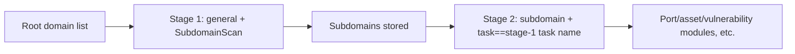

---

## name: scopesentry-mcp
description: Use ScopeSentry MCP to manage the security scanning platform (projects, tasks, templates, assets, nodes). Use it when the user mentions ScopeSentry, MCP, an API key, scan tasks, or asset queries.

# ScopeSentry MCP Usage Guide

For users with an **already-deployed ScopeSentry instance**. Connect to the platform via Cursor (or another MCP client) - no local source code needed.

## 1. Prerequisites

### 1.1 Confirm the service is reachable

- Default web UI: `http://<host>`
- MCP endpoint: `http://<host>/mcp` (if there is a reverse proxy or frontend proxy in front, use the actual `/mcp` address)

### 1.2 Create an API key

1. Log in to the ScopeSentry web UI in your browser
2. Go to the **API Key** management page to create a key (or create one through an endpoint provided by an admin)
3. Save the returned `ssk_...` string (**shown only once**)

### 1.3 Configure Cursor MCP

Cursor → Settings → MCP → Add server:

```json
{
  "mcpServers": {
    "scopesentry": {
      "url": "http://<your-host>:8082/mcp",
      "headers": {
        "X-API-Key": "ssk_your_key"
      }
    }
  }
}
```

You can also use: `Authorization: Bearer ssk_your_key`

After configuring, restart MCP or reload Cursor, and confirm that `list_projects`, `list_assets`, etc. appear in the tool list.

---

## 2. Tool overview


| Tool                     | Purpose             |
| ---------------------- | ----------------- |
| `list_projects`        | Project tree grouped by tag (includes project ID) |
| `list_projects_data`   | Paginated project list, searchable by name |
| `get_project`          | Project details |
| `create_project`       | Create a project |
| `list_tasks`           | Scan task list |
| `get_task`             | Task details |
| `list_scan_templates`  | Scan template list |
| `get_scan_template`    | Template details |
| `list_plugin_modules`  | Scan pipeline module names |
| `list_plugins`         | Available plugins (with hash and default parameters) |
| `create_scan_template` | Create a scan template |
| `create_scan_task`     | Create a scan task |
| `list_assets`          | Query assets of any type (paginated list) |
| `count_assets`         | Count assets (`/api/assets/common/total`) |
| `get_asset_detail`     | Asset or finding details |
| `add_asset_tag`        | Add a tag to an asset |
| `list_nodes`           | Scan node list |


Each tool's parameters are defined by its MCP tool description (schema); `list_assets` and `count_assets` share the same search/filter syntax, so before querying assets you can read the `list_assets` description first.

When you need to know "how many in total", use `count_assets` (which corresponds to the web UI's pagination total endpoint) instead of repeatedly paging through `list_assets` just to count.

---

## 3. Common workflows

### 3.1 Query assets by project

When the user or context **already specifies a project**, prefer including `filter.project` to narrow the scope and avoid slow responses from too much cross-project data. If no project is specified, project filtering is not mandatory.

1. Use `list_projects` or `list_projects_data` to get the target project's **ObjectID** (`id` / `children[].value`)
2. Pass `filter.project` to `list_assets` (**must be the ID, not the project's display name**)

```json
{
  "asset_type": "asset",
  "pageIndex": 1,
  "pageSize": 20,
  "search": "domain=^example.com",
  "filter": {
    "project": ["<project ObjectID>"]
  }
}
```

### 3.2 Create a scan task

1. Use `list_nodes` to get online node names
2. Use `list_scan_templates` or `create_scan_template` to get the template **ObjectID**
3. `create_scan_task`: `name` and `node` are required; `template` takes the template ID (not the template name)

**Target source `targetSource` (matches the web UI):**

| targetSource | Description | Required parameters |
| --- | --- | --- |
| `general` | Enter targets directly | `target` |
| `project` | Read targets from a project | `project` (array of project ObjectIDs) |
| `asset` | Search the web asset library | `search`; optional `project`, `filter`, `targetNumber` |
| `RootDomain` | Search the root domain library | `search`; optional `project`, `filter`, `targetNumber` |
| `subdomain` | Search the subdomain library | `search`; optional `project`, `filter`, `targetNumber` |
| `UrlScan` | Search URL scan results | `search`; optional `project`, `filter`, `targetNumber` |
| `*Source` (e.g. `subdomainSource`) | Created from "selected/search" on the asset page | Use `search` when `targetTp=search`; use `targetIds` when `targetTp=select` |

**Example - scan root domains directly:**

```json
{
  "name": "example-subdomain-collection",
  "node": ["node-1"],
  "template": "<template ObjectID>",
  "targetSource": "general",
  "target": "example.com\nfoo.com",
  "project": ["<project ObjectID>"]
}
```

**Example - continue scanning from the subdomain library (filtered by the previous task's name):**

```json
{
  "name": "example-port-and-vuln",
  "node": ["node-1"],
  "template": "<next-module template ObjectID>",
  "targetSource": "subdomain",
  "search": "task==\"example-subdomain-collection\"",
  "project": ["<project ObjectID>"]
}
```

### 3.3 Full root-domain information gathering (two stages recommended)

When the input is a **root domain** and you need **full information gathering**, scan in two passes rather than running the whole pipeline at once.

**Reason:** distributed tasks are dispatched per **single target**. When a root domain is the target, once a node is assigned that root domain, the subdomains discovered on that node also continue running subsequent modules on the same node, which easily causes uneven load, slow speed, and errors.

**Best practice:**

1. **Stage 1 - subdomain collection only**
   - `targetSource`: `general`
   - `target`: all root domains (one per line)
   - Template: enable only `SubdomainScan` and `SubdomainSecurity` (subdomain scanning + subdomain takeover)
   - Use `get_task` to wait for the task to finish

2. **Stage 2 - subsequent modules**
   - `targetSource`: `subdomain`
   - `search`: `task=="<stage-1 task name>"` (exact match on the task name)
   - Optionally use `project` to narrow the scope
   - Template: port scanning, asset mapping, vulnerability scanning, etc. (can omit SubdomainScan)
   - Subdomains are dispatched to nodes as independent targets, so parallel efficiency is higher

You can also achieve the same result in the web UI by filtering the "Subdomain" asset page by task name and using "Create task from subdomains".



### 3.4 Create a scan template

1. `list_plugin_modules` → list of module names
2. `list_plugins` (filterable by `module`) → each plugin's `hash` and default `parameter`
3. `create_scan_template`: use `modules` to specify "module → array of plugin hashes"

---

## 4. Asset queries (`list_assets` / `count_assets`)

`count_assets` uses the same `asset_type`, `search` and `filter` as `list_assets`, and returns `{ "total": N }`, corresponding to the web UI's `/api/assets/common/total` endpoint.

```json
{
  "asset_type": "subdomain",
  "search": "task==\"some task name\"",
  "filter": {"project": ["<project ObjectID>"]}
}
```

**Performance tip (applies to both `list_assets` and `count_assets`):** when there is a project condition, prefer `filter.project` to narrow the scope; for indexed fields in `search`, prefer exact match `==` or `^` prefix matching (see [4.3](#43-search-expression-syntax)) to avoid slow responses from broad `=` fuzzy queries. When there is no project context, project filtering is not mandatory.

See the table in [4.4](#44-filter-exact-matching) for which types support `filter.project`.

### 4.1 Asset type `asset_type`

`asset`, `RootDomain`, `subdomain`, `app`, `mp`, `UrlScan`, `SensitiveResult`, `DirScanResult`, `crawler`, `vulnerability`, `PageMonitoring`, `IPAsset`, `SubdomainTakerResult`

Alias examples: `web` → asset, `vuln` → vulnerability, `ip` → IPAsset, `url` → UrlScan

### 4.2 Parameter reference


| Parameter                | Description                                |
| ------------------------ | --------------------------------------- |
| `pageIndex` / `pageSize` | Pagination, default 1 / 20              |
| `search`                 | Search expression (see next section)    |
| `filter`                 | Exact-match filter JSON (see next section) |
| `sort`                   | Only UrlScan and DirScanResult support sorting by `length` |
| `sid`                    | SensitiveResult only: sensitive-rule name |


`search` and `filter` **can be used together**.

### 4.3 search expression syntax

A custom DSL (**not SQL**):


| Operator  | Meaning   | Indexed | Example                          |
| ---- | ---- | ---- | --------------------------- |
| `=`  | Fuzzy match (regex) | no | `domain=example`            |
| `==` | Exact match | **yes** | `port==443`                 |
| `!=` | Exclude   | - | `port!="80"`                |
| `&&` | And    | - | `domain==example.com && port==443` |
| `||` | Or    | - | `title=admin || body=login` |


**Indexing and operators:** fields such as `domain`, `ip`, `port`, `title` are indexed, but only an **exact `==` match** or a **prefix match where the value starts with `^`** (e.g. `domain=^example.com`) can use the index; **`=` turns into a regex fuzzy match and cannot use the index**, which can get slow on large datasets.

**search fields common to all types:** `tag`, `task` (task name), `rootDomain`

**`project` cannot be used in search** (it is either ignored or causes an error when combined with `&&`). Use `filter.project` to filter by project.

**Common search fields by type:**


| asset_type           | Fields                                                                               |
| -------------------- | ----------------------------------------------------------------------------------- |
| asset                | domain, ip, port, service, app, title, statuscode, icon, banner, type, body, header |
| RootDomain           | domain, icp, company                                                                |
| subdomain            | domain, ip, type, value                                                             |
| app                  | name, icp, company, category, description, url, apk                                 |
| mp                   | name, icp, company, category, description, url                                      |
| UrlScan              | url, input, source, resultId, type                                                  |
| SensitiveResult      | url, sname, body, info, md5                                                         |
| DirScanResult        | url, statuscode, redirect, length                                                   |
| vulnerability        | url, vulname, matched, request, response, level                                     |
| crawler              | url, method, body, resultId                                                         |
| PageMonitoring       | url, hash, diff, response                                                           |
| IPAsset              | ip, domain, port, service, webServer, app                                           |
| SubdomainTakerResult | domain, value, type, response                                                       |


**search examples:**

- `domain==www.example.com && port==443` (exact match, uses the index)
- `domain=^example.com` (prefix match, uses the index)
- `ip==192.168.1.1`
- `task=="some task name"`
- `level==high` (vulnerability)
- `statuscode==200` (DirScanResult)

Use `=` only when you need a fuzzy contains match, e.g. `title=admin` (does not use the index; best combined with a project or other condition to narrow the scope).

### 4.4 filter exact matching

A JSON object: multiple values under the same key are **OR**'d, different keys are **AND**'d.

**Prefer `project` when there is a project condition:** if the user or context has a specific project and the asset_type supports `project`, include it to narrow the scope; it is not mandatory when there is no project information.


| filter key   | Meaning       | Value notes                                                     |
| ------------ | -------- | -------------------------------------------------------- |
| `project`    | Owning project     | **ObjectID**, obtained via `list_projects` / `list_projects_data` |
| `task`       | Source task     | **Task name**, the `name` from `list_tasks`                         |
| `port`       | Port       | e.g. `"443"`                                                |
| `service`    | Service/protocol    | e.g. `"https"`                                              |
| `app`        | App fingerprint     | e.g. `"Nginx"`                                              |
| `icon`       | Icon hash  |                                                          |
| `statuscode` | HTTP status code | mainly used for asset                                               |
| `status`     | Status       | UrlScan/DirScan HTTP code; processing status for findings/sensitive-info results                       |
| `level`      | Finding severity     | critical / high / medium / low / info                    |
| `type`       | Type       | e.g. subdomain record type A, CNAME                                         |
| `color`      | Sensitive-rule color   | SensitiveResult                                          |
| `sname`      | Sensitive-rule name    | SensitiveResult                                          |
| `tags`       | Tags       |                                                          |


**Available filter keys by type:**


| asset_type                            | filter key                                                      |
| ------------------------------------- | --------------------------------------------------------------- |
| asset                                 | project, port, service, app, icon, statuscode, type, task, tags |
| RootDomain                            | project, tags                                                   |
| subdomain                             | project, type, task, tags                                       |
| app / mp                              | project, tags                                                   |
| UrlScan                               | status, tags                                                    |
| DirScanResult                         | status, tags                                                    |
| SensitiveResult                       | status, color, sname, tags                                      |
| crawler                               | project, task, tags                                             |
| vulnerability                         | project, level, status, task, tags                              |
| PageMonitoring / SubdomainTakerResult | tags                                                            |
| IPAsset                               | project, port, service, app                                     |


**filter examples:**

```json
{"project": ["<project ObjectID>"], "port": ["443"]}
```

**Combined query example:**

```json
{
  "asset_type": "asset",
  "search": "domain=^baidu && port==443",
  "filter": {"project": ["<project ObjectID>"]},
  "pageIndex": 1,
  "pageSize": 10
}
```

**Notes:**

- When there is a project condition, prefer including `filter.project` (when supported); not mandatory without project context
- Do not put the project's display name in `filter.project`
- Use `==` for known values and `^` for prefixes; avoid overusing `=` fuzzy matching on large tables
- Use `filter.status` for UrlScan's HTTP status; for DirScanResult you can use `statuscode==200` in search
- SensitiveResult by rule name: use `sname=<rule name>` in `search`, or `filter.sname`

### 4.5 Sorting with sort

Only supported by **UrlScan** and **DirScanResult**:

```json
{"length": "ascending"}
```

Other types ignore `sort` and default to sorting by time.

---

## 5. Scan template module names

`TargetHandler`, `SubdomainScan`, `SubdomainSecurity`, `PortScanPreparation`, `PortScan`, `PortFingerprint`, `AssetMapping`, `AssetHandle`, `URLScan`, `WebCrawler`, `URLSecurity`, `DirScan`, `VulnerabilityScan`, `PassiveScan`

---

## 6. Troubleshooting


| Symptom     | Fix                                                 |
| --------- | -------------------------------------------------- |
| No MCP tools   | Check the URL, API key, and whether ScopeSentry is running                    |
| 401 / 403 | Recreate or replace the API key                                    |
| Assets not found     | Confirm `filter.project` is an ObjectID; do not put project in search |
| Template/task creation fails | `template` must be a template ObjectID; `node` takes an online node name            |
| Query is slow/hangs   | Add `filter.project` when there is a project; for indexed fields in search use `==` or a `^` prefix instead of `=`; reduce `pageSize` |


---
